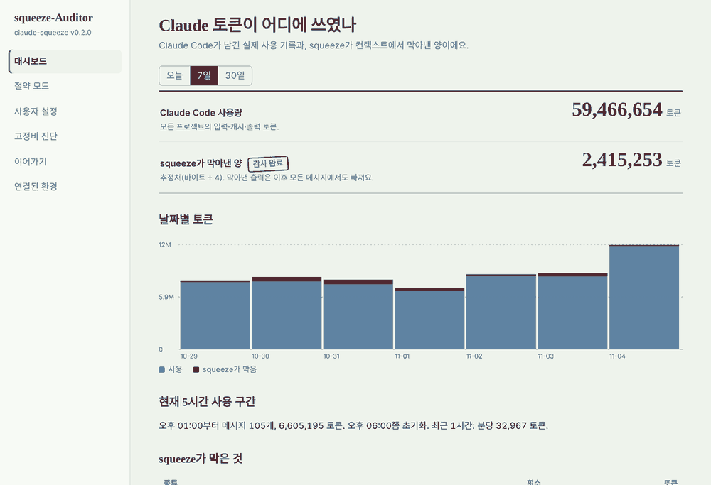

# claude-squeeze

[](https://github.com/jongwooish/claude-squeeze/actions/workflows/ci.yml) [](https://github.com/jongwooish/claude-squeeze/releases/latest) [](../v0.2-Auditor/v0.2.0_squeeze-auditor/Cargo.toml) [](../v0.2-Auditor/v0.2.0_squeeze-auditor/Cargo.toml) [](#설치) [](../LICENSE)

[English](README.md) | **한국어** | [日本語](README.ja.md) | [简体中文](README.zh-CN.md) | [Español](README.es.md) | [Français](README.fr.md)

> 💬 **피드백 환영.** 개선사항, v1.0 출시, 버전 업데이트, 설치 오류 등 어떤 문제든 [Issues에 남겨주세요](https://github.com/jongwooish/claude-squeeze/issues/new/choose) (6개 언어 모두 가능).

**Claude 토큰은 로그 쓰레기가 아니라 생각하는 데 쓰세요.**

squeeze는 긴 명령 출력, 큰 파일과 중복 파일 읽기, 너무 커진 세션, 안 쓰는 MCP 서버가 Claude의 컨텍스트에 들어가지 않게 막습니다. Claude는 에러와 경고를 그대로 봅니다. 설치형 앱 **squeeze-Auditor**에서 토큰이 어디에 쓰였는지 보고, squeeze가 얼마나 세게 줄일지 고를 수 있습니다.

- [효과](#효과) · [버전](#버전) · [어디에 적용되나](#어디에-적용되나) · [v0.2 squeeze-Auditor](#v02-squeeze-auditor) · [v0.1 Sentinel](#v01-sentinel) · [설치](#설치) · [사용법](#사용법) · [동작 원리](#동작-원리) · [로드맵](#로드맵) · [FAQ](#faq)

## 왜 필요한가

Claude Code는 요청할 때마다 대화 전체를 다시 보내고, 명령 출력도 대화의 일부입니다. `npm install`, 테스트 실행, `journalctl` 한 번이 수천 토큰을 추가하고, 그게 이후 모든 턴에 따라붙습니다. 정작 Claude에게 필요한 건 "통과" 한 줄이나 에러 세 줄인데도요.

squeeze는 그 출력이 컨텍스트에 들어가기 **전에** 막습니다.

## 효과

실제 로그 7개를 squeeze에 통과시킨 결과입니다 ([측정 방법](../v0.1-Sentinel/v0.1.0_squeeze-sentinel/docs/bench.md)):

| 로그 | 줄 수 전 → 후 | 토큰 전 → 후 (추정) | 절약 | 에러·경고 메시지 보존 |
|---|---:|---:|---:|---:|
| `pytest` 실행, 실패 2개 | 217 → 39 | 4,040 → 516 | **87.2%** | 11 / 11 |
| `go test -v`, 실패 1개 | 488 → 16 | 4,247 → 202 | **95.2%** | 4 / 4 |
| `make`, gcc 경고 + 에러 1개 | 370 → 44 | 7,046 → 850 | **87.9%** | 7 / 7 |
| `tsc`, 타입 에러 2개 | 124 → 9 | 1,310 → 172 | **86.9%** | 3 / 3 |
| `dpkg -l` 패키지 목록 | 1049 → 63 | 35,237 → 2,106 | **94.0%** | 8 / 8 |
| 서버 저널, OOM 강제 종료 (합성 데이터) | 1400 → 37 | 31,161 → 997 | **96.8%** | 5 / 5 |
| 짧은 `npm` 출력 | 16 → 16 | 287 → 287 | 0.0% (그대로 둠) | 12 / 12 |
| **합계** | | **83,325 → 5,128** | **93.8%** | **50 / 50** |

**왜 유용한가**

- **이 테스트에서 중요한 건 하나도 잃지 않았습니다.** 서로 다른 에러·경고 메시지가 전부 남았습니다. 반복되는 메시지는 한 번만 보여주고 개수를 붙입니다 (`… [same message 29 more times] …`).
- **짧은 출력은 절대 건드리지 않습니다.** 80줄·8KB 이하면 원본 그대로입니다.
- **절약은 매 턴 반복됩니다.** 31,000토큰짜리 로그가 다음 20턴 동안 컨텍스트에 남아 있으면 입력 토큰이 약 620,000개입니다. 약 1,000토큰으로 줄이면 같은 20턴에 약 20,000개입니다.
- **한도에 늦게 닿습니다.** 잡음이 적으면 컨텍스트가 천천히 차서, 대화 압축이나 요금제 한도에 더 늦게 도달합니다.
- **Claude가 더 잘 집중합니다.** "빌드가 왜 실패했지?"의 답이 1,000줄 속에 묻히지 않고 바로 앞에 있습니다.

**솔직한 한계:** 토큰 수는 추정값(바이트 ÷ 4)이고, 이 숫자는 저장된 로그를 재생해서 얻은 것이지 Claude Code를 실제로 켜고 끄며 비교한 결과가 아닙니다 (실사용 비교는 계획 중). 내 프로젝트에서 `squeeze report`를 실행하면 실제 숫자를 볼 수 있습니다.

**v0.2는 차단 기능 4가지를 더합니다.** 같은 토큰이 계속 다시 보내지는 것을 막습니다: 안 바뀐 파일 다시 읽기, 예산을 넘은 세션, 짧은 이어가기 메모로 새로 시작하는 게 나은 긴 세션, 안 쓰는 MCP 서버 같은 고정비. 효과는 쓰는 방식에 따라 다르므로 [v0.2 README](../v0.2-Auditor/v0.2.0_squeeze-auditor/README/README.ko.md#효과)에 계산을, squeeze-Auditor 대시보드에 내 실제 숫자를 보여 줍니다.

## 버전

버전마다 폴더와 README가 따로 있습니다. 릴리스는 레포 전체에 붙는 태그입니다.

| 버전 | 이름 | 추가되는 것 | 상태 |
|---|---|---|---|
| [v0.1](../v0.1-Sentinel/v0.1.0_squeeze-sentinel/README/README.ko.md) | **Sentinel** | 출력 많은 명령과 통째 파일 읽기를 잡는 Claude Code 훅, `squeeze run`, `compress`, `clip`, `report` | ✅ v0.1.0 |
| [v0.2](../v0.2-Auditor/v0.2.0_squeeze-auditor/README/README.ko.md) | **squeeze-Auditor** | 세션 차단 4가지(중복 읽기, 예산 일시 정지, 이어가기, 고정비), 사용량 대시보드와 절약 모드가 있는 설치형 앱 squeeze-Auditor, Claude 데스크톱 앱 지원 | ✅ v0.2.0 |
| v0.3 | *(이름 미정)* | 브라우저의 claude.ai와 모바일 앱, 토큰 불만에 대한 새로운 접근 | 🛠 계획 중 |

### 버전끼리의 관계

| 버전 | 설치하는 것 | 이전 버전이 필요한가? |
|---|---|---|
| v0.1 Sentinel | `squeeze` 프로그램 | — |
| v0.2 squeeze-Auditor | 같은 `squeeze` 프로그램 + 설치 파일, 시작 메뉴 앱(`squeeze-auditor`), 새 훅 | **아니요, v0.1을 포함합니다.** v0.1 위에 설치해도, 따로 설치해도 됩니다. |
| v0.3 | 계획 중 | 추후 안내 |

- **프로그램은 누적됩니다.** 새 `squeeze`에는 이전 기능이 모두 들어 있습니다. v0.1과 v0.2를 나란히 설치할 일은 없습니다.
- **폴더는 각 버전이 무엇을 더했는지 설명합니다.** 폴더를 설치하는 게 아닙니다.
- **설정은 그대로 이어집니다.** v0.1 `squeeze init`의 `.squeeze/config.json`과 훅은 업데이트 후에도 동작합니다. v0.2는 전체 설정 `~/.squeeze/config.json`을 더하고, Claude Code에 모든 프로젝트용으로 한 번 연결합니다.

| 이걸 쓴다면… | 설치 |
|---|---|
| Claude Code | squeeze-Auditor(v0.2) → **Claude Code 연결** |
| Claude 데스크톱 앱 | squeeze-Auditor(v0.2) → **데스크톱 앱 연결** |
| 브라우저의 claude.ai, 모바일 앱 | 지금은 긴 붙여넣기에 `squeeze clip`, 이후 v0.3 |

## 어디에 적용되나

| 어디서 | 효과 | 방법 |
|---|---|---|
| **Claude Code** | 자동, 모든 프로젝트 | squeeze-Auditor(또는 `squeeze setup`)가 `~/.claude/settings.json`에 훅을 넣습니다. v0.2 차단 4가지와 v0.1 가드 2가지가 모두 동작합니다. |
| **Claude 데스크톱 앱** (Windows, macOS) | Claude가 파일을 읽거나 이어가기를 저장할 때 | 연결하면 `squeeze mcp` 도구가 추가됩니다. Claude가 허용한 폴더의 로그만, 줄인 상태로 읽고, 이어가기 메모를 저장·불러옵니다. 대화 자체는 squeeze가 보거나 바꿀 수 없습니다. |
| **claude.ai (웹, 모바일)** | 수동, 긴 텍스트를 붙여넣을 때 | 로그를 복사하고 `squeeze clip` 실행 후 붙여넣기. v0.3에서 다룰 예정. |
| **다른 터미널 도구** | 수동 | `<명령> 2>&1 \| squeeze compress` |

Pro 요금제에서는 Claude Code와 claude.ai가 사용량 한도를 함께 쓰므로, Claude Code에서 아낀 토큰은 채팅에도 남습니다.

## v0.2 squeeze-Auditor

v0.1은 출력을 하나씩 봤습니다. **v0.2는 세션 전체를 봅니다**: Claude가 이미 무엇을 읽었는지, 대화가 얼마나 커졌는지, 메시지마다 무엇이 따라붙는지. 네 가지 낭비를 막습니다.

| 차단 | 무엇을 잡나 | 어떻게 막나 |
|---|---|---|
| **중복 읽기** | 바뀌지 않은 파일을 다시 통째로 읽기 | `Read`를 거부: "이미 갖고 있다". 파일이 바뀌거나 압축 후에는 다시 허용. |
| **예산 일시 정지** | 아주 커진 세션(기본 150K 토큰)에 계속 메시지 보내기 | 메시지를 한 번 멈추고 `/compact`나 `/clear`를 권함. 다시 보내면 그대로 보내짐. |
| **이어가기** | 지난 대화 전체를 매번 다시 읽는 긴 세션(기본 120K) | Claude가 짧은 이어가기 메모를 쓰고, `/clear` 후 새 세션은 대화 전체 대신 메모로 시작. |
| **고정비** | 메시지마다 보내지는 `CLAUDE.md`, 스킬, 에이전트, MCP 도구 목록 | 하나씩 재고, 안 쓰는 MCP 서버는 클릭 한 번으로 끔(Claude Code 자체 스위치). 14일 안 쓰면 자동으로 끄기도 가능. |

**squeeze-Auditor**는 시작 메뉴나 응용 프로그램에서 여는 앱입니다: 실제 Claude Code 사용량과 squeeze가 막은 양을 보여 주는 대시보드, 절약 모드(강하게, 균형, 가볍게), 모든 설정, 고정비 진단, 이어가기 메모, Claude Code·데스크톱 앱 연결.



v0.2 전체 문서: [v0.2-Auditor/v0.2.0_squeeze-auditor/README/README.ko.md](../v0.2-Auditor/v0.2.0_squeeze-auditor/README/README.ko.md).

## v0.1 Sentinel

Sentinel은 Claude Code와 셸 사이를 지키는 보초입니다. 단일 실행 파일, Rust, **의존성 0개**, macOS / Linux / Windows.

- **Bash 가드**: 출력이 많은 명령(`npm install`, `go test`, `cargo build`, `pytest`, `make`, `apt-get install`, `journalctl`, `docker build`, `kubectl logs`, `git log` 등)을 `squeeze run -- <명령>`으로 다시 실행하게 합니다. 이미 출력이 제한된 명령(`| tail -20`, `-n 50`, `> file`, `--quiet`)은 건드리지 않습니다.
- **Read 가드**: 400줄이 넘는 파일을 `offset`/`limit` 없이 읽으려 하면 우회합니다. Claude는 줄 번호가 붙은 목차를 받고 필요한 구간만 읽습니다.
- **똑똑한 압축**: 처음 8줄과 마지막 20줄, 모든 에러·경고와 앞뒤 2줄, 스택 트레이스를 남깁니다. 반복은 개수로 묶고, 에러를 경고보다 먼저 고릅니다.
- **종료 코드 유지**: `squeeze run`은 원래 명령의 종료 코드를 그대로 돌려줍니다.
- **전체 로그는 디스크에**: `.squeeze/raw/`, 최근 50개 유지, 본인만 읽기 가능. `.squeeze/`는 `.gitignore`에 추가됩니다.
- claude.ai용 **`squeeze clip`**, 실제 절약량을 보는 **`squeeze report`**.
- **안전 설계**: 훅은 절대 대신 승인하지 않고, 오류가 나면 조용히 물러나며(fail open), `squeeze uninstall`이 추가한 것을 모두 지웁니다. 네트워크 코드가 없습니다.

`squeeze run -- pytest -v` 후 Claude가 보는 것 (실제 출력, 217줄 → 39줄):

```
============================= test session starts ==============================
platform linux -- Python 3.13.18, pytest-9.1.1, pluggy-1.6.0 -- /usr/local/bin/python3
cachedir: .pytest_cache
rootdir: ~/project/
plugins: platformdirs-4.13.3, anyio-4.15.1
collecting ... collected 183 items

test_inventory.py::test_restock[0] PASSED                                [  0%]
… [178 lines omitted] …
test_inventory.py::test_restock[179] PASSED                              [ 98%]
test_inventory.py::test_negative PASSED                                  [ 98%]
test_inventory.py::test_bulk_order FAILED                                [ 99%]
test_inventory.py::test_missing_sku FAILED                               [100%]

=================================== FAILURES ===================================
… (트레이스백 2개는 전부 남음) …
=========================== short test summary info ============================
FAILED test_inventory.py::test_bulk_order - AssertionError: bulk order total ...
FAILED test_inventory.py::test_missing_sku - KeyError: 'B7'
======================== 2 failed, 181 passed in 0.14s =========================
[squeeze] 217 lines (15.8 KB) → 39 lines (1.9 KB). Full output: .squeeze/raw/20261103-044044-45b0e7.log (exit 1)
```

v0.1 전체 문서: [v0.1-Sentinel/v0.1.0_squeeze-sentinel/README.ko.md](../v0.1-Sentinel/v0.1.0_squeeze-sentinel/README/README.ko.md). 한국어 가이드: [docs/guide](../v0.1-Sentinel/v0.1.0_squeeze-sentinel/docs/guide/index.md).

## 설치

**설치 파일 (추천).** [최신 릴리스](https://github.com/jongwooish/claude-squeeze/releases/latest)에서:

| 시스템 | 파일 |
|---|---|
| Windows 10/11 | `squeeze-Auditor-0.2.0-setup-x64.exe` (ARM: `-setup-arm64.exe`) |
| macOS | `squeeze-Auditor-0.2.0-macos-arm64.pkg` (Intel: `-macos-x86_64.pkg`) |
| Linux (Debian, Ubuntu) | `squeeze-auditor_0.2.0_amd64.deb` (ARM: `_arm64.deb`) |

설치 파일에 아직 코드 서명이 없습니다. Windows SmartScreen: **추가 정보 → 실행**. macOS: 오른쪽 클릭 → **열기**. 자세히: [v0.2 설치](../v0.2-Auditor/v0.2.0_squeeze-auditor/README/README.ko.md#설치).

**터미널:**

```bash
# macOS / Linux
curl -fsSL https://raw.githubusercontent.com/jongwooish/claude-squeeze/main/INSTALL/install.sh | bash

# Windows (PowerShell)
irm https://raw.githubusercontent.com/jongwooish/claude-squeeze/main/INSTALL/install.ps1 | iex

# 소스에서 (Rust 1.80+가 있는 모든 OS)
cargo install --git https://github.com/jongwooish/claude-squeeze squeeze
```

릴리스의 모든 파일은 `checksums.txt`(SHA-256)에 있고, 설치 스크립트가 확인합니다. `SQUEEZE_VERSION=v0.1.0`으로 버전 고정, `SQUEEZE_INSTALL_DIR`로 폴더 변경.

## 빠른 시작

1. **squeeze-Auditor**를 열고 **Claude Code 연결**을 누릅니다(모든 프로젝트). 데스크톱 앱을 쓴다면 **연결된 환경**에서 연결하고 앱을 다시 시작하세요.
2. 평소처럼 Claude Code를 씁니다.
3. 대시보드에서 무엇을 막았는지 확인합니다. 세기는 **절약 모드**나 **사용자 설정**에서 바꿉니다.

터미널에서는:

```bash
squeeze setup      # Claude Code 연결 (데스크톱 앱이 있으면 함께)
claude             # 평소처럼 Claude Code 사용
squeeze auditor    # 창 열기
squeeze setup --remove
```

연결은 `~/.claude/settings.json`(데스크톱 앱은 `claude_desktop_config.json`)만 바꿉니다. 다른 설정과 훅은 그대로 두고, 바꾸기 전 원본을 `~/.squeeze/backups/`에 백업합니다. v0.1의 프로젝트별 `squeeze init`도 그대로 동작합니다.

## 사용법

| 명령 | 하는 일 |
|---|---|
| `squeeze auditor` | squeeze-Auditor 창 열기 |
| `squeeze setup [--claude-code] [--desktop] [--remove]` | Claude Code(모든 프로젝트)와 데스크톱 앱 연결·해제 |
| `squeeze doctor [--dir D] [--desktop] [--json]` | 메시지마다 보내지는 것(고정비) |
| `squeeze init [--dir D] [--bin PATH] [--dry-run]` | 한 프로젝트에만 훅 설치 (v0.1 방식) |
| `squeeze uninstall [--dir D] [--purge] [--dry-run]` | 프로젝트의 훅과 안내 제거; `--purge`는 `.squeeze/`도 삭제 |
| `squeeze run -- <명령>` | 명령 실행; 출력이 길면 짧은 요약 |
| `<명령> 2>&1 \| squeeze compress` | 파이프 출력 압축 |
| `squeeze clip [--print]` | 클립보드 압축 (claude.ai용) |
| `squeeze report [--since 7d] [--global] [--json]` | 절약량 보기 |
| `squeeze bench <dir> [--markdown]` | `*.log` 파일을 재생해 측정 |
| `squeeze mcp` | 데스크톱 앱이 실행하는 MCP 서버 |
| `squeeze version` | 버전 출력 |

명령 앞에 `SQUEEZE_SKIP=1`을 붙이면 한 번만 원본 출력을, 메시지에 `SQUEEZE_SKIP`을 넣으면 예산 일시 정지를 건너뜁니다. 설정: [v0.2 설정](../v0.2-Auditor/v0.2.0_squeeze-auditor/README/README.ko.md#설정).

## 동작 원리

```
Claude가 실행하려 함:  npm test
        │
        ▼
PreToolUse 훅 ── squeeze hook pre-bash
        │  출력이 많은 명령? ── 아니요 ──▶ 조용히 통과, 평소 권한 확인
        │  예
        ▼
거부 + 힌트: "squeeze run -- 'npm test' 로 실행하세요"
        │
        ▼
Claude가 실행: squeeze run -- 'npm test'   (평소 권한 규칙 그대로 적용)
        │
        ├─▶ 전체 출력 ── .squeeze/raw/<시각>.log
        └─▶ 짧은 출력 ── Claude  (에러, 경고, 처음, 끝, 로그 경로)
```

왜 명령을 몰래 바꾸지 않고 "거부 + 힌트"일까요? 명령을 바꿔치기하는 훅은 그 명령을 승인까지 해야 해서, 사용자의 권한 확인을 건너뛰게 됩니다. squeeze는 절대 대신 승인하지 않습니다.

### 래퍼 도구와 다른 점

[chaude](https://github.com/int-ttt/chaude) 같은 도구는 Claude Code CLI를 자체 화면으로 감싸고, 세션을 갈아타거나 싼 모델에 일을 넘겨 토큰을 아낍니다. squeeze는 문제의 반대편을 맡습니다:

- **래퍼가 아닙니다.** Claude Code 자체 훅을 통해 동작하므로 `claude`를 그대로 씁니다.
- **꽉 찬 컨텍스트를 치우는 대신, 처음부터 잡음이 못 들어오게** 합니다.
- **둘을 함께 쓸 수 있습니다.**

## 로드맵

- [x] **v0.1 Sentinel**: Claude Code 훅, `run`, `compress`, `clip`, `report`, `bench`
- [x] **v0.2 squeeze-Auditor**: 중복 읽기·예산·이어가기·고정비 차단, 대시보드와 절약 모드가 있는 설치형 앱, Claude 데스크톱 앱 도구
- [ ] **v0.3**: 브라우저의 claude.ai와 모바일 앱, 사람들이 가장 많이 말하는 토큰 문제에 대한 새로운 접근
- [ ] 코드 서명된 설치 파일
- [ ] 실제 Claude Code A/B 벤치마크 (같은 작업, squeeze 켜고 끄고)
- [ ] v1.0: 명령과 설정 안정화

## FAQ

**Q. Claude가 중요한 걸 놓칠 수 있나요?**
A. 모든 테스트 로그에서 서로 다른 에러·경고 메시지는 전부 남았습니다. 요약으로 부족하면 마지막 줄에 전체 로그 경로가 있습니다. 중복 읽기를 막을 때도 정말 필요하면 다시 읽는 방법을 Claude에게 알려 줍니다.

**Q. squeeze가 내 데이터를 어딘가로 보내나요?**
A. 아니요. 네트워크 코드가 없습니다. squeeze-Auditor 창은 내 컴퓨터만 열 수 있는 `127.0.0.1` 페이지입니다.

**Q. Claude Code 세션을 망가뜨릴 수 있나요?**
A. 훅은 실패해도 안전합니다: 이상한 입력, 없는 파일, 내부 오류가 나면 아무 출력 없이 끝나고 Claude Code는 평소처럼 진행합니다. squeeze는 도구 실행을 대신 승인하지 않습니다.

**Q. 일반 claude.ai 채팅에서도 토큰이 줄어드나요?**
A. `squeeze clip`으로 긴 텍스트를 붙여넣을 때만요. 브라우저와 모바일 앱은 v0.3에서 다룹니다.

**Q. 대시보드 숫자가 내 요금제 한도인가요?**
A. 아닙니다. 이 컴퓨터의 Claude Code 기록을 읽은 숫자입니다. 다른 프로그램이 요금제 사용량을 읽는 공식 방법은 없습니다.

**Q. 왜 0.x 버전인가요?**
A. 메이저 버전이 0인 동안은 명령 이름과 설정이 바뀔 수 있습니다. v1.0은 안정되었다는 뜻입니다.

## 레포 구조

```
claude-squeeze/
├── README/                      ← 6개 언어 개요 (README.md = 영어)
├── CHANGELOG/                   ← 6개 언어 CHANGELOG
├── v0.1-Sentinel/               ← v0.1 Sentinel
│   ├── README.md                   버전 개요
│   └── v0.1.0_squeeze-sentinel/   ← 릴리스된 v0.1.0 그대로 (동결)
├── v0.2-Auditor/                ← v0.2 squeeze-Auditor
│   ├── README.md                   버전 개요
│   └── v0.2.0_squeeze-auditor/    ← v0.2: 현재 squeeze 프로그램 (Rust, 의존성 없음)
│       ├── README.md               v0.2 전체 문서 (영어)
│       ├── README/                 번역 (5개 언어)
│       ├── src/                    엔진, 훅, 차단 기능, squeeze-Auditor 서버
│       ├── ui/                     squeeze-Auditor 창 (HTML 파일 하나)
│       ├── packaging/              Windows·macOS·Linux 설치 파일, 아이콘
│       ├── docs/                   벤치마크, 사용자 가이드(한국어), 스크린샷
│       └── testdata/fixtures/      테스트와 벤치마크용 로그
├── INSTALL/                     ← install.sh / install.ps1
├── CARGO/                       ← Cargo.toml / Cargo.lock (Rust 워크스페이스)
├── .github/                     ← 이슈 양식, CI, 릴리스, 첫 화면 README
├── CLAUDE.md
└── LICENSE
```

## 기여하기

```bash
cargo test --manifest-path CARGO/Cargo.toml
cargo clippy --manifest-path CARGO/Cargo.toml --all-targets -- -D warnings
cargo run --manifest-path CARGO/Cargo.toml --release -- bench v0.2-Auditor/v0.2.0_squeeze-auditor/testdata/fixtures
```

새 테스트 로그를 환영합니다: 실제 `*.log`(비밀과 개인 경로는 지우고)를 `v0.2-Auditor/v0.2.0_squeeze-auditor/testdata/fixtures/`에 넣어 주세요. 서로 다른 에러·경고가 하나라도 빠지면 테스트가 실패합니다. 버그와 아이디어: [GitHub Issues](https://github.com/jongwooish/claude-squeeze/issues).

## 커뮤니티

**문제를 찾았거나 아이디어가 있다면 [Issues](https://github.com/jongwooish/claude-squeeze/issues/new/choose)에 남겨주세요.** 개선사항, v1.0 출시, 버전 업데이트, 설치 오류 등 어떤 소프트웨어 문제든 다음 버전을 만드는 데 큰 도움이 됩니다.


| 이럴 때 | 여기로 |
|---|---|
| 버그나 세션이 망가지는 문제 | [Issues → Bug report](https://github.com/jongwooish/claude-squeeze/issues/new?template=bug_report.yml) |
| 중요한 줄이 빠짐, 절약이 적음, 명령이 잘못 잡히거나 안 잡힘 | [Issues → Compression problem](https://github.com/jongwooish/claude-squeeze/issues/new?template=compression.yml) |
| 설치·업데이트·버전 문제 | [Issues → Install, update or version problem](https://github.com/jongwooish/claude-squeeze/issues/new?template=version_problem.yml) |
| 기능 제안 | [Issues → Feature idea](https://github.com/jongwooish/claude-squeeze/issues/new?template=feature_request.yml) |
| 질문, 문제 해결 도움 | [Discussions → Q&A](https://github.com/jongwooish/claude-squeeze/discussions/categories/q-a) |
| 로드맵, v1.0에 들어갈 것에 대한 의견 | [Discussions → Ideas](https://github.com/jongwooish/claude-squeeze/discussions/categories/ideas) |
| 새 버전 소식 받기 | [Discussions → Announcements](https://github.com/jongwooish/claude-squeeze/discussions/categories/announcements)와 [Releases](https://github.com/jongwooish/claude-squeeze/releases) (**Watch → Custom → Releases**를 누르면 알림이 옵니다) |

6개 언어 중 아무 언어로나 써도 됩니다. 보안 문제는 [SECURITY.md](../.github/SECURITY.md), 기여 방법은 [CONTRIBUTING.md](../.github/CONTRIBUTING.md)를 보세요.

## 라이선스

MIT. [LICENSE](../LICENSE) 참고. squeeze는 비공식 커뮤니티 도구이며 Anthropic과 관련이 없습니다.
