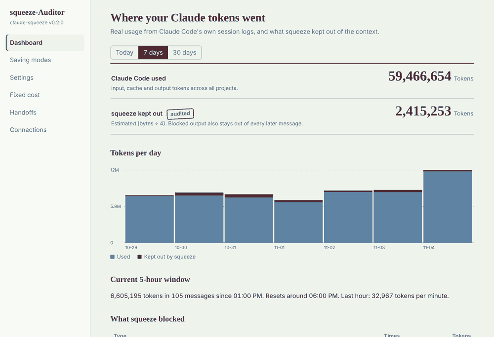
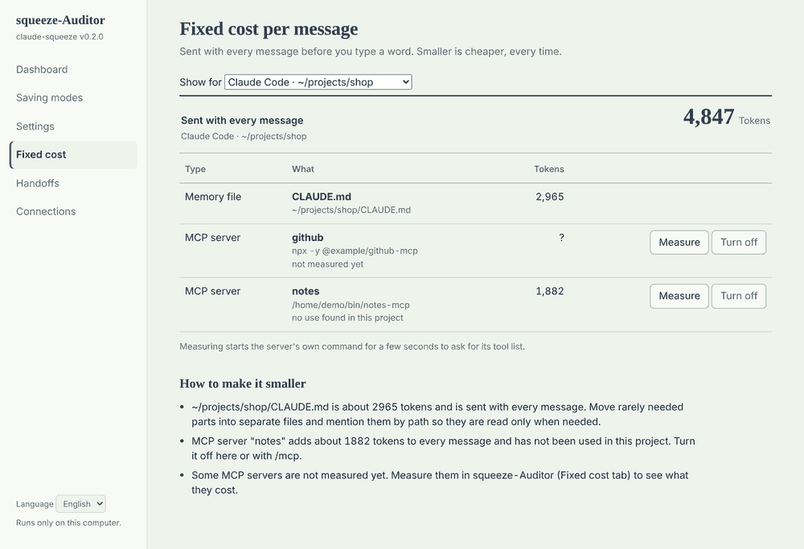

# v0.2.0 squeeze-Auditor

[English](../README.md) | [한국어](README.ko.md) | [日本語](README.ja.md) | [简体中文](README.zh-CN.md) | **Español** | [Français](README.fr.md)

> 💬 **Se agradecen los comentarios.** Mejoras, la versión 1.0, actualizaciones, errores de instalación o cualquier otro problema: [abre un issue](https://github.com/jongwooish/claude-squeeze/issues/new/choose) (en cualquiera de los 6 idiomas).

← [Volver a squeeze](../../../README/README.es.md)

v0.1 Sentinel detenía una salida larga cada vez. **v0.2 Auditor mira la sesión completa.** Recuerda lo que Claude ya leyó, vigila cuánto ha crecido la conversación y revisa lo que se envía con cada mensaje antes de que escribas nada. Y bloquea cuatro tipos de desperdicio que mirar solo el tamaño no detecta.

Es un programa instalable: ejecuta el instalador, abre **squeeze-Auditor** desde el menú Inicio (o Aplicaciones) y verás en qué se gastaron tus tokens, qué dejó fuera squeeze, y podrás cambiar cuánto ahorra.

**Funciona en:** Claude Code (todos los proyectos) y la app de escritorio de Claude (Windows y macOS). claude.ai en el navegador y las apps móviles llegan en v0.3.
**Requiere:** nada. v0.2 es el mismo programa `squeeze` que v0.1, con todo lo que hacía v0.1 y lo que se describe abajo. Ver [cómo encajan las versiones](../../../README/README.es.md#cómo-encajan-las-versiones).



## Novedades: cuatro bloqueos

| | Bloqueo | Qué detecta | Cómo bloquea |
|---|---|---|---|
| 1 | **Lectura repetida** | Claude vuelve a leer entero un archivo que no ha cambiado | Se rechaza el `Read` con «ya lo leíste, usa lo que tienes». Se permite de nuevo en cuanto el archivo cambia o la conversación se compacta. |
| 2 | **Pausa por presupuesto** | Sigues enviando mensajes a una sesión que ya es enorme | Antes de enviar, squeeze retiene el mensaje una vez y sugiere `/compact` o `/clear`. Envíalo de nuevo (↑, Enter) y pasa. Solo vuelve a preguntar cuando la sesión ha crecido otro 50 %. |
| 3 | **Traspaso (handoff)** | Una sesión larga que vuelve a leer todo su historial | Cuando la sesión supera el tamaño de traspaso, Claude escribe una nota breve antes de parar. Ejecutas `/clear` y la nueva sesión empieza desde la nota (unos 1000 tokens) en lugar de toda la conversación. |
| 4 | **Coste fijo** | Lo que viaja con *cada* mensaje: archivos `CLAUDE.md` y sus importaciones, descripciones de skills y agentes, listas de herramientas de los servidores MCP | squeeze-Auditor mide cada uno. Apaga con un clic los servidores MCP sin uso, con el propio interruptor de Claude Code (el mismo de `/mcp`). Opcional: apagar automáticamente los servidores que un proyecto no ha usado en 14 días. |

### En qué se diferencia de v0.1

| | v0.1 Sentinel | v0.2 Auditor |
|---|---|---|
| Mira | el tamaño de **una** salida o archivo | la **sesión**: lo leído antes, su tamaño actual, lo que viaja siempre |
| Decide por | «¿esta salida es larga?» | memoria (mismo archivo, sin cambios), totales (tamaño de la sesión), historial (servidores nunca usados) |
| Hooks | `PreToolUse` (Bash, Read) | además `UserPromptSubmit`, `Stop`, `SessionStart`, `PreCompact` |
| Se instala con | `squeeze init` por proyecto | instalador o `squeeze setup`, una vez para **todos** los proyectos |
| Lo ves en | `squeeze report` en una terminal | la ventana de squeeze-Auditor |

Todo lo de v0.1 sigue funcionando: los comandos ruidosos pasan por `squeeze run` y los archivos grandes reciben un índice.

## La ventana de squeeze-Auditor

| Pestaña | Qué puedes hacer |
|---|---|
| **Panel** | Uso real de Claude Code según sus propios registros de sesión (hoy, 7 o 30 días), junto a lo que squeeze dejó fuera. La ventana de 5 horas actual y el ritmo de consumo. Lo bloqueado, por tipo. Sesiones recientes con su tamaño frente al presupuesto. |
| **Modos de ahorro** | Fuerte, Equilibrado (por defecto) o Ligero, con los valores que fija cada uno. O Personalizado. |
| **Ajustes** | Todos los valores: cuándo se comprime la salida, cuántas líneas se conservan, el tamaño de archivo grande, el presupuesto, el tamaño y estilo del traspaso, las reglas de coste fijo, comandos que nunca se tocan. |
| **Coste fijo** | Por proyecto (o la app de escritorio): cada archivo de memoria, importación, skill, agente y servidor MCP con sus tokens por mensaje. Medir un servidor MCP, encenderlo o apagarlo. Consejos para reducirlo. |
| **Traspasos** | Todas las notas de traspaso, legibles en el sitio. |
| **Conexiones** | Conectar o desconectar Claude Code y la app de escritorio. Elegir qué carpetas puede leer la app de escritorio. |

La ventana es una pequeña página que squeeze sirve solo en `127.0.0.1`, con una clave nueva en cada arranque, mostrada en una ventana de aplicación de Edge o Chrome (o tu navegador por defecto). Se cierra sola poco después de cerrar la ventana. Nada sale de tu ordenador. En inglés y coreano.



## Efecto

**Compresión de salida** (de v0.1, sin cambios): siete registros reales, 83 325 → 5128 tokens estimados (**−93,8 %**), todos los errores y avisos distintos conservados. Método: [docs/bench.md](../docs/bench.md).

**Los cuatro bloqueos** ahorran de otra manera: impiden que los mismos tokens se envíen una y otra vez. Lo que valen depende de cómo trabajes, así que aquí va la aritmética, no un benchmark:

| Bloqueo | Ejemplo | Fuera del contexto |
|---|---|---|
| Lectura repetida | Un archivo de 600 líneas (unos 7000 tokens) leído otra vez sin cambios | unos 7000 tokens, más otro tanto en cada mensaje posterior de la sesión |
| Pausa / traspaso | Seguir 20 mensajes más en una sesión de 150 000 tokens, frente a una sesión nueva desde una nota de 1000 tokens | unos 3 000 000 de tokens de entrada releídos, frente a unos 20 000 más el trabajo nuevo |
| Coste fijo | Un servidor MCP sin uso con 12 herramientas (1882 tokens, medido en un servidor de prueba) durante 100 mensajes | unos 188 000 tokens |

**Límites, con franqueza.**
- Los tokens son estimaciones (bytes ÷ 4). La mayor parte de una sesión larga se relee desde la caché de prompts de Claude, que cuesta menos que la entrada nueva, así que el ahorro en coste es menor de lo que sugiere el número de tokens. Aun así llena la ventana de contexto y cuenta para el uso.
- El uso del panel sale de los registros locales de Claude Code. No incluye claude.ai ni las conversaciones de la app de escritorio, y no es el límite oficial de tu plan. La ventana de 5 horas es una estimación de cómo la cuenta Claude Code.
- squeeze no puede ver las conversaciones de la app de escritorio. Allí ahorra solo cuando Claude lee registros con las herramientas de squeeze o cuando le pides guardar un traspaso.

## Instalación

Descarga desde la [última versión](https://github.com/jongwooish/claude-squeeze/releases/latest):

| Sistema | Archivo | Después |
|---|---|---|
| Windows 10/11 (la mayoría de PC) | `squeeze-Auditor-0.2.0-setup-x64.exe` | Ejecútalo. No requiere administrador. Menú Inicio → **squeeze-Auditor** |
| Windows en ARM | `squeeze-Auditor-0.2.0-setup-arm64.exe` | Igual |
| macOS, Apple silicon | `squeeze-Auditor-0.2.0-macos-arm64.pkg` | Ábrelo. Aplicaciones → **squeeze-Auditor** |
| macOS, Intel | `squeeze-Auditor-0.2.0-macos-x86_64.pkg` | Igual |
| Linux (Debian, Ubuntu) | `squeeze-auditor_0.2.0_amd64.deb` / `_arm64.deb` | `sudo apt install ./squeeze-auditor_0.2.0_amd64.deb` y luego el menú de aplicaciones |

**Los instaladores aún no están firmados**, así que Windows y macOS pueden detenerlos la primera vez. Consulta [Si el sistema lo bloquea](#si-el-sistema-lo-bloquea).

Instalación por terminal (ambos programas, sin icono en el menú Inicio):

```bash
# macOS / Linux
curl -fsSL https://raw.githubusercontent.com/jongwooish/claude-squeeze/main/INSTALL/install.sh | bash
# Windows (PowerShell)
irm https://raw.githubusercontent.com/jongwooish/claude-squeeze/main/INSTALL/install.ps1 | iex
# Desde el código (Rust 1.80+)
cargo install --git https://github.com/jongwooish/claude-squeeze squeeze
```

### Si el sistema lo bloquea

Los archivos de la versión aún no están firmados, así que Windows y macOS no pueden saber quién los hizo. Los compila GitHub Actions a partir de este repositorio. Antes de saltarte un aviso, comprueba que el archivo coincide con `checksums.txt` de la página de la versión:

```bash
# macOS
shasum -a 256 -c checksums.txt --ignore-missing
# Linux
sha256sum -c checksums.txt --ignore-missing
# Windows (PowerShell): compara con el hash de la página de la versión
Get-FileHash .\squeeze-Auditor-0.2.0-setup-x64.exe -Algorithm SHA256
```

**Windows**
- **SmartScreen** («Windows protegió su PC»): **Más información** → **Ejecutar de todas formas**.
- **Control inteligente de aplicaciones** («El Control inteligente de aplicaciones bloqueó una aplicación que puede no ser segura»): no hay botón para ejecutarlo igualmente, y revisa todos los programas, así que tras instalar también bloquearía `squeeze.exe` y `squeeze-auditor.exe`. Prueba squeeze en una máquina virtual o en Windows Sandbox, o desactívalo: Seguridad de Windows → Control de aplicaciones y navegador → Configuración de Control inteligente de aplicaciones → **Desactivado**. En Windows 11 25H2 y posteriores puedes volver a activarlo; en versiones anteriores sigue desactivado hasta reinstalar Windows.
- **Zip descargado con el navegador**: antes de extraerlo, clic derecho → Propiedades → **Desbloquear**, o `Unblock-File .\squeeze-*.zip`.
- **Antivirus**: informa del falso positivo a tu proveedor o añade una excepción para `%LOCALAPPDATA%\Programs\squeeze`.

**macOS**
- **«no se puede abrir» / «desarrollador no identificado»**: Ajustes del Sistema → Privacidad y seguridad → desplázate hacia abajo → **Abrir igualmente** junto al nombre del archivo, y escribe tu contraseña. En macOS 15 y posteriores, clic derecho → Abrir ya no se salta esta comprobación.
- **«está dañado y no se puede abrir»**: la app aún tiene la marca de descarga. Ejecuta `xattr -dr com.apple.quarantine /Applications/squeeze-Auditor.app`.
- **Programas de terminal del `.tar.gz`**: `xattr -d com.apple.quarantine squeeze squeeze-auditor`.

**Linux**
- Instala el `.deb` con `sudo apt install ./squeeze-auditor_0.2.0_amd64.deb`. Algunos centros de software avisan de paquetes de fuera de tu distribución; apt en una terminal no.
- **«Permission denied»** con los programas del `.tar.gz`: `chmod +x squeeze squeeze-auditor`. Si la carpeta está montada con `noexec` (algunos `/tmp` y USB), muévelos a `~/.local/bin`.
- Otras distribuciones (Fedora, Arch, etc.): usa el `.tar.gz` o la instalación por terminal de arriba.

## Inicio rápido

1. Instala y abre **squeeze-Auditor**. (En Windows, el instalador puede conectar Claude Code por ti: deja la casilla marcada.)
2. Pulsa **Conectar Claude Code**. Añade los hooks de squeeze a `~/.claude/settings.json` para todos los proyectos. Tus otros ajustes y hooks se conservan, y antes se guarda una copia.
3. ¿Usas la app de escritorio de Claude? Ve a **Conexiones**, pulsa **Conectar**, añade las carpetas cuyos registros puede leer Claude y reinicia la app.
4. Usa Claude Code como siempre. Vuelve al Panel para ver qué se dejó fuera.

Desde una terminal: `squeeze setup` (conectar), `squeeze setup --remove` (desconectar), `squeeze auditor` (abrir la ventana).

**Si vienes de v0.1:** instala encima (el instalador de Windows usa la misma carpeta que `install.ps1` de v0.1) y conecta una vez. Los proyectos donde ejecutaste `squeeze init` siguen funcionando; puedes dejar sus hooks o quitarlos con `squeeze uninstall`. En Windows, desinstalar squeeze-Auditor también lo desconecta de Claude Code y de la app de escritorio; en macOS y Linux ejecuta antes `squeeze setup --remove`.

## Qué pasa durante una sesión

```
SessionStart ──▶ ¿hay una nota de traspaso reciente?   ──sí──▶ cargarla en la nueva sesión
     │
Escribes un mensaje
     │
UserPromptSubmit ──▶ ¿sesión ≥ presupuesto (150K)?     ──sí──▶ retenerlo una vez: «/compact o /clear, o envía otra vez»
     │
Claude trabaja
     ├─ Bash ──▶ ¿comando ruidoso?                      ──sí──▶ «ejecútalo como squeeze run -- …»   (v0.1)
     └─ Read ──▶ ¿lectura completa de un archivo grande? ──sí──▶ índice + lectura por rango         (v0.1)
                 ¿mismo archivo, sin cambios, ya leído entero? ──sí──▶ «usa lo que leíste»          (v0.2)
     │
Stop ──▶ ¿sesión ≥ tamaño de traspaso (120K)?          ──sí──▶ Claude escribe .squeeze/handoff/<hora>.md
     │                                                          y te dice que ejecutes /clear
PreCompact ──▶ olvidar qué archivos se leyeron (Claude ya no los tiene)
```

Todos los hooks fallan en abierto: ante cualquier error no producen salida y Claude Code sigue. squeeze nunca aprueba una herramienta por ti.

## App de escritorio de Claude

Conectar añade una entrada a `claude_desktop_config.json`: un servidor MCP, `squeeze mcp`, con seis herramientas.

| Herramienta | Qué hace |
|---|---|
| `read_log` | Lee un registro o archivo de texto ya comprimido (o un rango exacto de líneas) |
| `tail_log` | Las últimas líneas de un registro, comprimidas |
| `search_log` | Líneas que coinciden, con algo de contexto |
| `list_logs` | Archivos de una carpeta permitida |
| `save_handoff` / `load_handoff` | Guardar la conversación como nota de traspaso y empezar otra desde ella |

Claude solo puede leer las carpetas que indiques en **Conexiones**. En lugar de pegar un registro de 5000 líneas en el chat, pide «lee el último error del registro de mi app» y Claude recibe la versión corta. Cuando la conversación sea larga, pide a Claude que guarde un traspaso, abre otra conversación y pídele que lo cargue.

## Modos de ahorro

| | Fuerte | Equilibrado (por defecto) | Ligero |
|---|---:|---:|---:|
| Salida intacta hasta | 40 líneas | 80 líneas | 150 líneas |
| Archivo grande a partir de | 250 líneas | 400 líneas | 800 líneas |
| Pausa por presupuesto en | 100K tokens | 150K tokens | 200K tokens |
| Traspaso en | 80K tokens | 120K tokens | 160K tokens |

## Configuración

Los ajustes globales están en `~/.squeeze/config.json` (los escribe la pestaña Ajustes). Un proyecto puede sobrescribir cualquier clave en su `.squeeze/config.json`. Todas las claves de v0.1 siguen valiendo ([lista](../../../v0.1-Sentinel/v0.1.0_squeeze-sentinel/README/README.es.md#configuración)). Nuevas en v0.2:

| Clave | Por defecto | Significado |
|---|---|---|
| `profile` | `"balanced"` | `strong`, `balanced`, `light` o `custom` |
| `dup_read` | `true` | Bloquear relecturas completas de archivos sin cambios |
| `budget.enabled` / `budget.tokens` | `true` / `150000` | Pausa por presupuesto y su tamaño |
| `handoff.enabled` / `handoff.tokens` | `true` / `120000` | Traspaso y su tamaño |
| `handoff.mode` | `"note"` | `note` (escribir una nota y cargarla tras `/clear`) o `remind` (solo sugerir `/compact`) |
| `handoff.max_age_hours` | `48` | Las notas más antiguas no se cargan |
| `mcp_prune.enabled` / `unused_days` | `false` / `14` | Apagar servidores MCP que un proyecto no usa |
| `desktop.allowed_dirs` | `[]` | Carpetas que puede leer la app de escritorio |

Pon `SQUEEZE_SKIP` en cualquier parte de un mensaje para que pase la pausa por presupuesto.

## Comandos

| Comando | Qué hace |
|---|---|
| `squeeze auditor` | Abre la ventana de squeeze-Auditor |
| `squeeze setup [--claude-code] [--desktop] [--remove]` | Conecta o desconecta Claude Code (todos los proyectos) y la app de escritorio |
| `squeeze doctor [--dir D] [--desktop] [--json]` | Coste fijo por mensaje, en la terminal |
| `squeeze mcp` | El servidor MCP que ejecuta la app de escritorio |
| `squeeze init`, `run`, `compress`, `clip`, `report`, `bench`, `uninstall` | Como en [v0.1](../../../v0.1-Sentinel/v0.1.0_squeeze-sentinel/README/README.es.md#uso) |

## Privacidad y seguridad

- **Solo local.** No hay código de red salvo la propia página `127.0.0.1` de la ventana, que exige una clave que cambia en cada arranque.
- **Copias de seguridad.** Antes de cambiar `~/.claude/settings.json`, `~/.claude.json` o `claude_desktop_config.json`, squeeze copia el original en `~/.squeeze/backups/`.
- **Solo lectura cuando es posible.** squeeze lee los registros de sesión de Claude Code para los números; nunca los modifica ni lee tus credenciales.
- **Medir un servidor MCP** arranca su propio comando unos segundos para pedir su lista de herramientas, igual que haría Claude Code.

## FAQ

**P. ¿La pausa por presupuesto no estorbará?**
R. Retiene un mensaje una sola vez por etapa. Envía el mismo mensaje otra vez y pasa. Puedes subir el presupuesto, elegir Ligero o desactivarla en Ajustes.

**P. ¿El traspaso pierde contexto?**
R. Algo de detalle, a propósito: la nota guarda el objetivo, lo hecho, las decisiones, los archivos tocados y los siguientes pasos. Las notas son archivos normales en `.squeeze/handoff/`; léelas o edítalas antes de `/clear`. ¿Prefieres decidir tú? Elige el estilo «Solo recordármelo».

**P. ¿Por qué no el navegador y el móvil?**
R. Una pestaña del navegador o una app móvil no pueden ejecutar un programa instalado junto a Claude. v0.3 usará otro enfoque.

**P. ¿El panel muestra el límite de mi plan?**
R. No. Muestra lo que dicen los registros de Claude Code en este ordenador. Anthropic no ofrece una forma oficial para que otros programas lean el uso del plan.

**P. ¿Puedo volver a v0.1?**
R. Sí: `squeeze setup --remove` y luego instala v0.1.0 (`SQUEEZE_VERSION=v0.1.0` con el script de instalación).

## Comentarios

Deja mejoras y problemas en [Issues](https://github.com/jongwooish/claude-squeeze/issues/new/choose): un bloqueo que saltó cuando no debía, problemas con el instalador, números que parecen incorrectos, ideas para v0.3 y v1.0. Las preguntas van a [Discussions](https://github.com/jongwooish/claude-squeeze/discussions). Cualquiera de los seis idiomas vale.

## Contribuir

```bash
cargo test --manifest-path CARGO/Cargo.toml
cargo clippy --manifest-path CARGO/Cargo.toml --all-targets -- -D warnings
cargo run --manifest-path CARGO/Cargo.toml --release -- bench v0.2-Auditor/v0.2.0_squeeze-auditor/testdata/fixtures
cargo run --manifest-path CARGO/Cargo.toml -- auditor     # abrir la ventana desde el código
```

Mapa del código: `src/guards.rs` (lectura repetida, presupuesto, traspaso), `src/mcp.rs` y `src/doctor.rs` (coste fijo), `src/transcripts.rs` y `src/usage.rs` (números del panel), `src/auditor.rs` y `ui/index.html` (la ventana), `src/mcp_server.rs` (herramientas de la app de escritorio), `packaging/` (instaladores). Guía de usuario en coreano: [docs/guide](../docs/guide/index.md).
