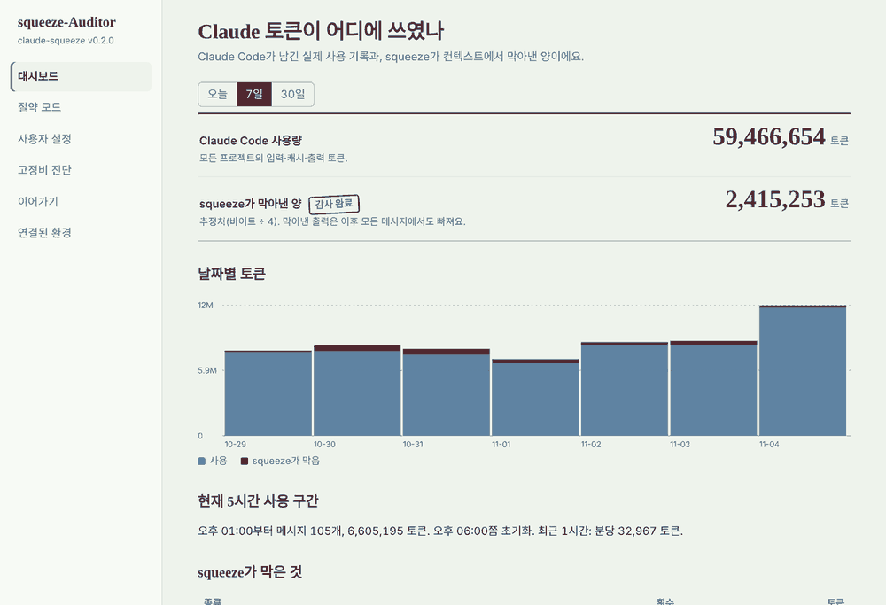

# v0.2.0 squeeze-Auditor

[English](../README.md) | **한국어** | [日本語](README.ja.md) | [简体中文](README.zh-CN.md) | [Español](README.es.md) | [Français](README.fr.md)

> 💬 **피드백 환영.** 개선사항, v1.0 출시, 버전 업데이트, 설치 오류 등 어떤 문제든 [Issues에 남겨주세요](https://github.com/jongwooish/claude-squeeze/issues/new/choose) (6개 언어 모두 가능).

← [squeeze로 돌아가기](../../../README/README.ko.md)

v0.1 Sentinel은 긴 출력을 하나씩 막았습니다. **v0.2 Auditor는 세션 전체를 봅니다.** Claude가 이미 무엇을 읽었는지 기억하고, 대화가 얼마나 커졌는지 지켜보고, 내가 글자를 치기도 전에 메시지마다 함께 보내지는 것들을 점검합니다. 그리고 크기만 봐서는 알 수 없는 네 가지 낭비를 막습니다.

설치형 프로그램입니다. 설치 파일을 실행하고 시작 메뉴(또는 응용 프로그램)에서 **squeeze-Auditor**를 열면, 토큰이 어디에 쓰였는지, squeeze가 무엇을 막았는지 보고, 얼마나 세게 줄일지 바꿀 수 있습니다.

**동작하는 곳:** Claude Code(모든 프로젝트)와 Claude 데스크톱 앱(Windows, macOS). 브라우저의 claude.ai와 모바일 앱은 v0.3에서 다룹니다.
**필요한 것:** 없음. v0.2는 v0.1과 같은 `squeeze` 프로그램이고, v0.1의 기능을 모두 포함한 채 아래 기능이 더해졌습니다. [버전끼리의 관계](../../../README/README.ko.md#버전끼리의-관계) 참고.



## 새 기능: 4가지 차단

| | 차단 | 무엇을 잡나 | 어떻게 막나 |
|---|---|---|---|
| 1 | **중복 읽기** | 바뀌지 않은 파일을 Claude가 또 통째로 읽을 때 | `Read`를 거부하고 "이미 읽었으니 그 내용을 쓰라"고 알려 줍니다. 파일이 바뀌거나 대화가 압축되면 바로 다시 허용합니다. |
| 2 | **예산 일시 정지** | 이미 아주 커진 세션에 메시지를 계속 보낼 때 | 메시지를 보내기 전에 한 번 멈추고 `/compact`나 `/clear`를 권합니다. 다시 보내면(↑, Enter) 그대로 보내집니다. 세션이 50% 더 커지기 전에는 다시 묻지 않습니다. |
| 3 | **이어가기 (핸드오프)** | 긴 세션이 매번 지난 대화 전체를 다시 읽을 때 | 세션이 이어가기 크기를 넘으면, Claude가 멈추기 전에 짧은 이어가기 메모를 씁니다. `/clear` 하면 새 세션이 대화 전체 대신 메모(약 1,000 토큰)로 시작합니다. |
| 4 | **고정비** | *모든* 메시지에 따라붙는 것: `CLAUDE.md`와 불러온 파일, 스킬·에이전트 설명, MCP 서버의 도구 목록 | squeeze-Auditor가 하나씩 잽니다. 안 쓰는 MCP 서버는 클릭 한 번으로 끕니다(`/mcp`와 같은 Claude Code 자체 스위치). 선택: 프로젝트에서 14일 동안 안 쓴 서버를 자동으로 끄기. |

### v0.1과 무엇이 다른가

| | v0.1 Sentinel | v0.2 Auditor |
|---|---|---|
| 보는 것 | 출력·파일 **하나**의 크기 | **세션**: 전에 읽은 것, 지금 크기, 매번 따라붙는 것 |
| 판단 기준 | "이 출력이 긴가?" | 기억(같은 파일, 안 바뀜), 누적(세션 크기), 사용 기록(한 번도 안 쓴 서버) |
| 훅 | `PreToolUse` (Bash, Read) | 추가로 `UserPromptSubmit`, `Stop`, `SessionStart`, `PreCompact` |
| 설치 | 프로젝트마다 `squeeze init` | 설치 파일 또는 `squeeze setup`, **모든** 프로젝트에 한 번 |
| 확인 | 터미널의 `squeeze report` | squeeze-Auditor 창 |

v0.1의 기능은 그대로 동작합니다: 출력 많은 명령은 `squeeze run`으로, 큰 파일은 목차로.

## squeeze-Auditor 창

| 탭 | 할 수 있는 것 |
|---|---|
| **대시보드** | Claude Code 자체 세션 기록에서 읽은 실제 사용량(오늘, 7일, 30일)과 squeeze가 막아낸 양. 현재 5시간 구간과 사용 속도. 종류별로 막은 것. 최근 세션의 크기와 예산 대비. |
| **절약 모드** | 강하게, 균형(기본), 가볍게와 각 모드의 숫자. 또는 직접 설정. |
| **사용자 설정** | 모든 값: 언제 출력을 줄일지, 몇 줄 남길지, 큰 파일 기준, 예산, 이어가기 크기와 방식, 고정비 규칙, 절대 건드리지 않을 명령. |
| **고정비 진단** | 프로젝트별(또는 데스크톱 앱): 메모리 파일, 불러온 파일, 스킬, 에이전트, MCP 서버마다 메시지당 토큰. MCP 서버 측정, 켜기·끄기. 줄이는 방법. |
| **이어가기** | 모든 이어가기 메모를 바로 읽기. |
| **연결된 환경** | Claude Code와 Claude 데스크톱 앱 연결·해제. 데스크톱 앱이 읽을 수 있는 폴더 정하기. |

창은 squeeze가 `127.0.0.1`에서만 띄우는 작은 페이지이고, 실행할 때마다 바뀌는 열쇠가 있어야 열립니다. Edge나 Chrome 앱 창(없으면 기본 브라우저)으로 보여 주고, 창을 닫으면 잠시 뒤 스스로 꺼집니다. 컴퓨터 밖으로 나가는 것은 없습니다. 영어와 한국어를 지원합니다.


## 효과

**출력 압축**(v0.1부터, 그대로): 실제 로그 7개, 추정 83,325 → 5,128 토큰(**−93.8%**), 서로 다른 에러·경고는 모두 남음. 방법: [docs/bench.md](../docs/bench.md).

**4가지 차단**은 다른 방식으로 아낍니다. 같은 토큰이 계속 다시 보내지는 것을 막습니다. 얼마나 아끼는지는 쓰는 방식에 따라 다르므로, 벤치마크가 아니라 계산으로 보여 드립니다.

| 차단 | 예 | 막는 양 |
|---|---|---|
| 중복 읽기 | 안 바뀐 600줄 파일(약 7,000 토큰)을 다시 읽음 | 약 7,000 토큰, 그리고 세션의 이후 모든 메시지마다 그만큼 |
| 예산 정지 / 이어가기 | 150,000 토큰 세션으로 20번 더 대화 vs 1,000 토큰 메모로 새 세션 시작 | 약 3,000,000 입력 토큰 재전송 vs 약 20,000 + 새 작업 |
| 고정비 | 도구 12개짜리 안 쓰는 MCP 서버(테스트 서버 측정값 1,882 토큰), 메시지 100번 | 약 188,000 토큰 |

**솔직한 한계.**
- 토큰 수는 추정치(바이트 ÷ 4)입니다. 긴 세션의 대부분은 Claude의 프롬프트 캐시에서 다시 읽히고 캐시는 새 입력보다 싸므로, 실제 비용 절약은 토큰 수보다 작습니다. 그래도 컨텍스트 창을 채우고 사용량에 들어갑니다.
- 대시보드의 사용량은 이 컴퓨터의 Claude Code 세션 기록에서 나옵니다. claude.ai나 데스크톱 앱 자체 대화는 포함되지 않고, 요금제의 공식 한도 수치도 아닙니다. 5시간 구간은 Claude Code의 계산 방식을 흉내 낸 추정입니다.
- squeeze는 데스크톱 앱의 대화를 볼 수 없습니다. 데스크톱 앱에서는 Claude가 squeeze 도구로 로그를 읽거나, 이어가기 저장을 부탁할 때만 아낍니다.

## 설치

[최신 릴리스](https://github.com/jongwooish/claude-squeeze/releases/latest)에서 받으세요.

| 시스템 | 파일 | 그다음 |
|---|---|---|
| Windows 10/11 (대부분의 PC) | `squeeze-Auditor-0.2.0-setup-x64.exe` | 실행. 관리자 권한 필요 없음. 시작 메뉴 → **squeeze-Auditor** |
| Windows ARM | `squeeze-Auditor-0.2.0-setup-arm64.exe` | 같음 |
| macOS, Apple 실리콘 | `squeeze-Auditor-0.2.0-macos-arm64.pkg` | 열기. 응용 프로그램 → **squeeze-Auditor** |
| macOS, Intel | `squeeze-Auditor-0.2.0-macos-x86_64.pkg` | 같음 |
| Linux (Debian, Ubuntu) | `squeeze-auditor_0.2.0_amd64.deb` / `_arm64.deb` | `sudo apt install ./squeeze-auditor_0.2.0_amd64.deb`, 그다음 앱 메뉴 |

**설치 파일에 아직 코드 서명이 없어서** Windows와 macOS가 처음 한 번 막을 수 있습니다. [시스템이 막을 때](#시스템이-막을-때)를 보세요.

터미널로 설치(두 프로그램 모두, 시작 메뉴 아이콘 없음):

```bash
# macOS / Linux
curl -fsSL https://raw.githubusercontent.com/jongwooish/claude-squeeze/main/INSTALL/install.sh | bash
# Windows (PowerShell)
irm https://raw.githubusercontent.com/jongwooish/claude-squeeze/main/INSTALL/install.ps1 | iex
# 소스에서 (Rust 1.80+)
cargo install --git https://github.com/jongwooish/claude-squeeze squeeze
```

### 시스템이 막을 때

릴리스 파일에 아직 코드 서명이 없어서 Windows와 macOS는 누가 만들었는지 알 수 없습니다. 파일은 이 저장소에서 GitHub Actions가 빌드합니다. 경고를 넘기기 전에 릴리스 페이지의 `checksums.txt`와 같은지 먼저 확인하세요.

```bash
# macOS
shasum -a 256 -c checksums.txt --ignore-missing
# Linux
sha256sum -c checksums.txt --ignore-missing
# Windows (PowerShell): 릴리스 페이지의 해시와 비교
Get-FileHash .\squeeze-Auditor-0.2.0-setup-x64.exe -Algorithm SHA256
```

**Windows**
- **SmartScreen** ("Windows의 PC 보호"): **추가 정보** → **실행**.
- **스마트 앱 컨트롤** ("스마트 앱 컨트롤이 안전하지 않을 수 있는 앱을 차단했습니다"): 그래도 실행하는 버튼이 없고, 모든 프로그램을 검사하기 때문에 설치한 뒤 `squeeze.exe`, `squeeze-auditor.exe`도 막힙니다. 가상 머신이나 Windows 샌드박스에서 써 보거나, 끄세요: Windows 보안 → 앱 및 브라우저 컨트롤 → 스마트 앱 컨트롤 설정 → **끄기**. Windows 11 25H2 이상은 나중에 다시 켤 수 있고, 그 전 버전은 한 번 끄면 Windows를 다시 설치할 때까지 꺼져 있습니다.
- **브라우저로 받은 zip**: 압축을 풀기 전에 오른쪽 클릭 → 속성 → **차단 해제**, 또는 `Unblock-File .\squeeze-*.zip`.
- **백신**: 백신 회사에 오탐으로 신고하거나 `%LOCALAPPDATA%\Programs\squeeze`를 예외로 추가하세요.

**macOS**
- **"열 수 없음" / "확인되지 않은 개발자"**: 시스템 설정 → 개인정보 보호 및 보안 → 아래로 스크롤 → 파일 이름 옆 **그래도 열기** → 암호 입력. macOS 15 이상에서는 오른쪽 클릭 → 열기로 이 검사를 건너뛸 수 없습니다.
- **"손상되었기 때문에 열 수 없습니다"**: 다운로드 표시가 남아 있는 것입니다. `xattr -dr com.apple.quarantine /Applications/squeeze-Auditor.app`을 실행하세요.
- **`.tar.gz`의 터미널 프로그램**: `xattr -d com.apple.quarantine squeeze squeeze-auditor`.

**Linux**
- `.deb`는 `sudo apt install ./squeeze-auditor_0.2.0_amd64.deb`로 설치하세요. 일부 소프트웨어 센터는 배포판 밖의 패키지라고 경고하지만 터미널의 apt는 그렇지 않습니다.
- `.tar.gz` 프로그램이 **"Permission denied"**: `chmod +x squeeze squeeze-auditor`. 폴더가 `noexec`로 마운트돼 있으면(일부 `/tmp`, USB) `~/.local/bin`으로 옮기세요.
- 다른 배포판(Fedora, Arch 등)은 `.tar.gz`나 위의 터미널 설치를 쓰세요.

## 빠른 시작

1. 설치하고 **squeeze-Auditor**를 엽니다. (Windows 설치 파일은 마지막에 Claude Code 연결까지 해 줍니다. 체크를 그대로 두세요.)
2. **Claude Code 연결**을 누릅니다. 모든 프로젝트용 훅을 `~/.claude/settings.json`에 넣습니다. 다른 설정과 훅은 그대로 두고, 바꾸기 전에 백업합니다.
3. Claude 데스크톱 앱을 쓴다면 **연결된 환경**에서 **연결**을 누르고, Claude가 읽을 로그 폴더를 적은 뒤 데스크톱 앱을 다시 시작합니다.
4. 평소처럼 Claude Code를 씁니다. 대시보드에서 무엇을 막았는지 확인하세요.

터미널에서는: `squeeze setup`(연결), `squeeze setup --remove`(해제), `squeeze auditor`(창 열기).

**v0.1에서 올라올 때:** 그 위에 설치하고(Windows 설치 파일은 v0.1 `install.ps1`과 같은 폴더를 씁니다) 한 번 연결하세요. `squeeze init`을 했던 프로젝트도 계속 동작합니다. 그 훅은 그대로 둬도 되고 `squeeze uninstall`로 지워도 됩니다. Windows에서는 squeeze-Auditor를 제거하면 Claude Code와 데스크톱 앱 연결도 해제됩니다. macOS와 Linux에서는 먼저 `squeeze setup --remove`를 실행하세요.

## 세션 동안 일어나는 일

```
SessionStart ──▶ 최근 이어가기 메모가 있나?       ──예──▶ 새 세션에 불러오기
     │
메시지 입력
     │
UserPromptSubmit ──▶ 세션 ≥ 예산(150K)?          ──예──▶ 한 번 멈춤: "/compact나 /clear, 또는 다시 보내기"
     │
Claude 작업
     ├─ Bash ──▶ 출력 많은 명령?                  ──예──▶ "squeeze run -- …로 실행"            (v0.1)
     └─ Read ──▶ 큰 파일 통째 읽기?               ──예──▶ 목차 + 구간 읽기                      (v0.1)
                 전에 통째로 읽은, 안 바뀐 파일?   ──예──▶ "읽은 내용을 쓰라"                   (v0.2)
     │
Stop ──▶ 세션 ≥ 이어가기 크기(120K)?             ──예──▶ Claude가 .squeeze/handoff/<시각>.md 작성
     │                                                    후 /clear 하라고 안내
PreCompact ──▶ 읽은 파일 기록 지우기 (Claude가 더 이상 갖고 있지 않으므로)
```

모든 훅은 오류가 나면 아무 출력 없이 끝나고 Claude Code는 평소처럼 진행합니다. squeeze는 도구 실행을 대신 승인하지 않습니다.

## Claude 데스크톱 앱

연결하면 `claude_desktop_config.json`에 항목 하나가 추가됩니다: 도구 6개를 가진 MCP 서버 `squeeze mcp`.

| 도구 | 하는 일 |
|---|---|
| `read_log` | 로그·텍스트 파일을 줄인 상태로(또는 정확한 줄 구간으로) 읽기 |
| `tail_log` | 로그의 마지막 부분, 줄여서 |
| `search_log` | 일치하는 줄과 앞뒤 조금 |
| `list_logs` | 허용된 폴더의 파일 목록 |
| `save_handoff` / `load_handoff` | 지금 대화를 이어가기 메모로 저장하고, 새 대화에서 불러오기 |

Claude는 **연결된 환경**에 적은 폴더만 읽을 수 있습니다. 5,000줄 로그를 채팅에 붙여 넣는 대신 "내 앱 로그의 마지막 에러 읽어 줘"라고 하면 Claude는 짧은 버전을 받습니다. 대화가 길어지면 이어가기 저장을 부탁하고, 새 대화에서 불러오라고 하세요.

## 절약 모드

| | 강하게 | 균형 (기본) | 가볍게 |
|---|---:|---:|---:|
| 이 줄 수까지는 출력 그대로 | 40줄 | 80줄 | 150줄 |
| 큰 파일 기준 | 250줄 | 400줄 | 800줄 |
| 예산 일시 정지 | 100K 토큰 | 150K 토큰 | 200K 토큰 |
| 이어가기 시작 | 80K 토큰 | 120K 토큰 | 160K 토큰 |

## 설정

전체 설정은 `~/.squeeze/config.json`에 있습니다(사용자 설정 탭이 씁니다). 프로젝트의 `.squeeze/config.json`에서 어떤 키든 덮어쓸 수 있습니다. v0.1의 키도 모두 그대로 동작합니다([목록](../../../v0.1-Sentinel/v0.1.0_squeeze-sentinel/README/README.ko.md#설정)). v0.2에서 새로 생긴 키:

| 키 | 기본값 | 의미 |
|---|---|---|
| `profile` | `"balanced"` | `strong`, `balanced`, `light`, `custom` |
| `dup_read` | `true` | 안 바뀐 파일 다시 통째로 읽기 차단 |
| `budget.enabled` / `budget.tokens` | `true` / `150000` | 예산 일시 정지와 그 크기 |
| `handoff.enabled` / `handoff.tokens` | `true` / `120000` | 이어가기와 그 크기 |
| `handoff.mode` | `"note"` | `note`(메모 작성, `/clear` 후 불러오기) 또는 `remind`(`/compact` 권하기만) |
| `handoff.max_age_hours` | `48` | 이보다 오래된 메모는 불러오지 않음 |
| `mcp_prune.enabled` / `unused_days` | `false` / `14` | 프로젝트에서 안 쓰는 MCP 서버 끄기 |
| `desktop.allowed_dirs` | `[]` | 데스크톱 앱이 읽을 수 있는 폴더 |

메시지 어디에든 `SQUEEZE_SKIP`을 넣으면 예산 일시 정지를 건너뜁니다.

## 명령

| 명령 | 하는 일 |
|---|---|
| `squeeze auditor` | squeeze-Auditor 창 열기 |
| `squeeze setup [--claude-code] [--desktop] [--remove]` | Claude Code(모든 프로젝트)와 데스크톱 앱 연결·해제 |
| `squeeze doctor [--dir D] [--desktop] [--json]` | 메시지당 고정비를 터미널에서 |
| `squeeze mcp` | 데스크톱 앱이 실행하는 MCP 서버 |
| `squeeze init`, `run`, `compress`, `clip`, `report`, `bench`, `uninstall` | [v0.1](../../../v0.1-Sentinel/v0.1.0_squeeze-sentinel/README/README.ko.md#사용법)과 같음 |

## 개인정보와 안전

- **이 컴퓨터 안에서만.** 창의 `127.0.0.1` 페이지 말고는 네트워크 코드가 없고, 그 페이지도 실행할 때마다 바뀌는 열쇠가 필요합니다.
- **백업.** `~/.claude/settings.json`, `~/.claude.json`, `claude_desktop_config.json`을 바꾸기 전에 원본을 `~/.squeeze/backups/`에 복사합니다.
- **가능한 한 읽기만.** 숫자를 위해 Claude Code 세션 기록을 읽지만 바꾸지 않고, 로그인 정보는 절대 읽지 않습니다.
- **MCP 서버 측정**은 Claude Code가 하듯 그 서버의 명령을 몇 초 동안 실행해 도구 목록을 물어봅니다.

## FAQ

**Q. 예산 일시 정지가 방해되지 않나요?**
A. 단계마다 한 번만 멈춥니다. 같은 메시지를 다시 보내면 그대로 보내집니다. 사용자 설정에서 예산을 올리거나, 가볍게 모드를 고르거나, 끌 수 있습니다.

**Q. 이어가기를 하면 맥락을 잃나요?**
A. 세부 내용 일부는 일부러 버립니다. 메모에는 목표, 한 일, 결정, 건드린 파일, 다음 할 일이 남습니다. 메모는 `.squeeze/handoff/`의 평범한 파일이라 `/clear` 전에 읽거나 고칠 수 있습니다. 직접 판단하고 싶다면 이어가기 방식을 "알려주기만"으로 바꾸세요.

**Q. 왜 브라우저와 휴대폰은 안 되나요?**
A. 브라우저 탭과 휴대폰 앱은 Claude 옆에서 설치형 프로그램을 돌릴 수 없습니다. v0.3에서 다른 방식으로 다룹니다.

**Q. 대시보드 숫자가 내 요금제 한도인가요?**
A. 아닙니다. 이 컴퓨터의 Claude Code 기록이 말하는 숫자입니다. 다른 프로그램이 요금제 사용량을 읽을 수 있는 공식 방법은 Anthropic이 제공하지 않습니다.

**Q. v0.1로 돌아갈 수 있나요?**
A. 네. `squeeze setup --remove` 후 v0.1.0을 설치하세요(설치 스크립트에 `SQUEEZE_VERSION=v0.1.0`).

## 피드백

개선사항과 문제를 [Issues](https://github.com/jongwooish/claude-squeeze/issues/new/choose)에 남겨 주세요: 막지 말아야 할 때 막은 경우, 설치 문제, 이상해 보이는 숫자, v0.3과 v1.0 아이디어. 질문은 [Discussions](https://github.com/jongwooish/claude-squeeze/discussions)로. 6개 언어 모두 괜찮습니다.

## 기여

```bash
cargo test --manifest-path CARGO/Cargo.toml
cargo clippy --manifest-path CARGO/Cargo.toml --all-targets -- -D warnings
cargo run --manifest-path CARGO/Cargo.toml --release -- bench v0.2-Auditor/v0.2.0_squeeze-auditor/testdata/fixtures
cargo run --manifest-path CARGO/Cargo.toml -- auditor     # 소스에서 창 열기
```

코드 지도: `src/guards.rs`(중복 읽기, 예산, 이어가기), `src/mcp.rs`와 `src/doctor.rs`(고정비), `src/transcripts.rs`와 `src/usage.rs`(대시보드 숫자), `src/auditor.rs`와 `ui/index.html`(창), `src/mcp_server.rs`(데스크톱 앱 도구), `packaging/`(설치 파일). 한국어 사용자 가이드: [docs/guide](../docs/guide/index.md).
